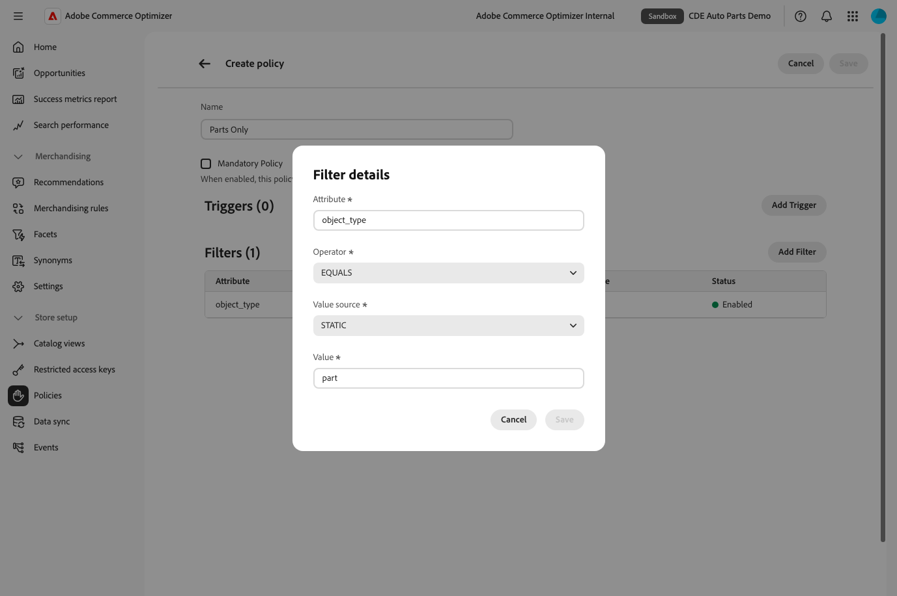
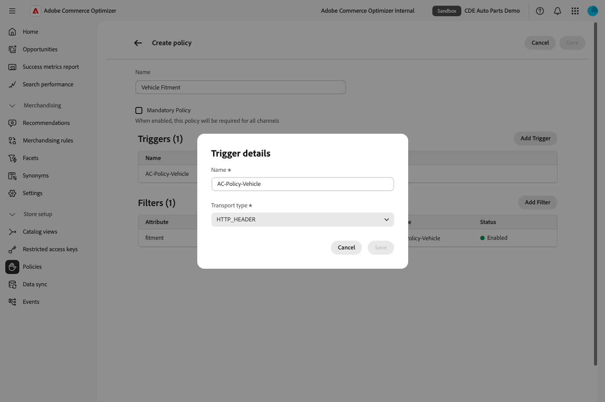
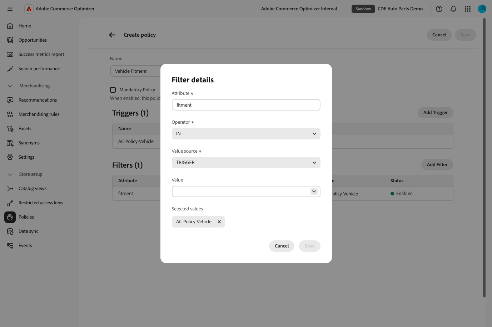
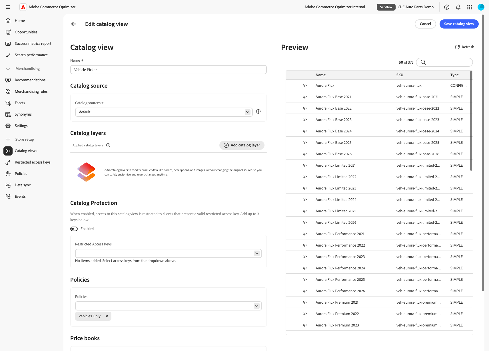
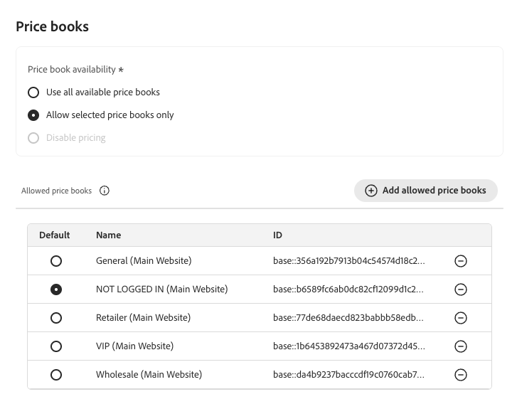
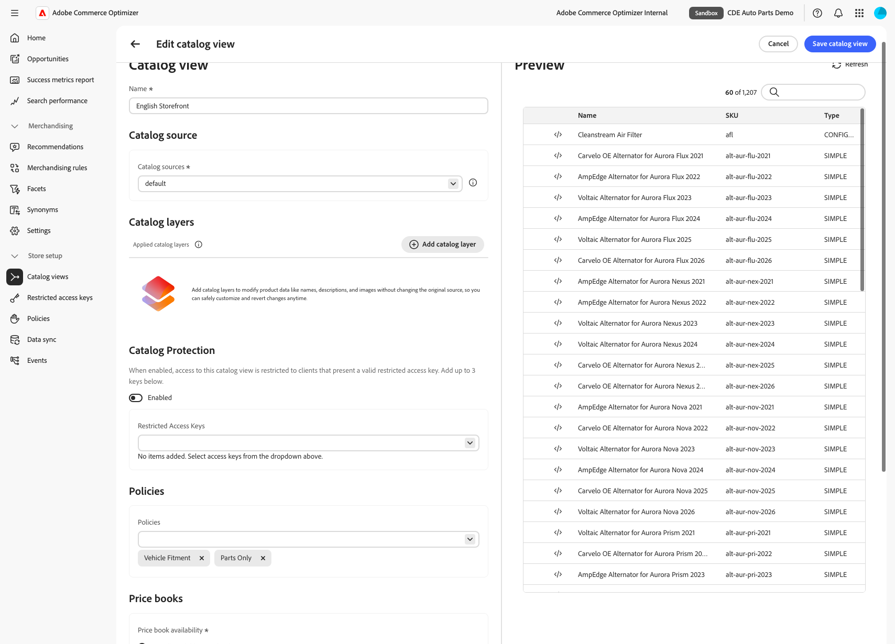

# Sample catalog data ingestion

This sample data set emulates the catalog data for a fictional B2B2X Automobile conglomerate called Carvelo. When ingested, this sample data creates a single base catalog that can be configured and filtered to deliver custom catalogs for different sales channels, locales, and customer segments.

The sample catalog data ingestion process described here is a prerequisite for completing the [Storefront and Catalog Administrator end-to-end use case](https://experienceleague.adobe.com/en/docs/commerce/optimizer/use-case/admin-use-case) that demonstrates how to create custom catalogs to support sales operations for a complex business organization.


## About this repository

This repository provides the tools to ingest the sample data set into a Commerce Optimizer instance. The process uses the [Commerce Optimizer SDK](https://github.com/adobe-commerce/aco-ts-sdk/) which is based on the [Data Ingestion API](https://developer.adobe.com/commerce/services/optimizer/data-ingestion/).

Also, you can use this repository code as the basis for loading your own commerce data to create a single base catalog to power any Commerce front end:

- Update the metadata, products, price books, and prices data in the [data files](https://github.com/adobe-commerce/aco-sample-catalog-data-ingestion/tree/main/data) with your own commerce data.
- Run the script to load the sample data.
- Use the Merchandising GraphQL APIs to retrieve catalog data for your frontend.


## The fitment catalog model

This dataset models an auto-parts catalog whose headline feature is **"shop by vehicle" fitment**: parts are matched to vehicles through a dedicated `fitment` attribute rather than through the category tree.

```json
{
  "code": "fitment",
  "values": [
    "veh-bolt-scout-base-2025",
    "veh-bolt-scout-premium-2025",
    "veh-bolt-scout-performance-2025",
    "veh-bolt-scout-limited-2025"
  ]
}
```

- **Vehicles are reference configurable products.** Each model line (e.g. `veh-aurora-flux`) is a configurable product whose variants are its `trim` × `year` combinations, carrying  `make` / `model` / `trim` / `year` attributes that power the vehicle-picker widget. Since the vehicles and the parts share the same catalog, the vehicles carry an `object_type: "vehicle"` so that  Commerce Optimizer Policy can filter them out of the shopper experience.
- **Parts** are marked `object_type: "part"` and carry a multi-valued `fitment` attribute on the parent product. This attribute contains the list of vehicle variant SKUs indicating the vehicle models that they fit, plus a `UNIVERSAL` marker indicating universally fitting parts.

## What will you do?

You will ingest `Product Metadata`, `Product`, `Category Metadata`, `Category`, `Price Book`, and `Price` data for the Carvelo Automotive demo dataset:

1. **Directly into Commerce Optimizer** via the Commerce Optimizer TypeScript SDK (`npm run ingest`).
2. **Into Adobe Commerce (PaaS)** via the Admin REST API (`npm run ingest:paas`), so the [PaaS → ACO connector](https://experienceleague.adobe.com/en/docs/commerce/aco-optimizer-connector/connector-sync-pipeline) re-exports the catalog to Commerce Optimizer. See [paas/PAAS_TO_ACO.md](paas/PAAS_TO_ACO.md) for detailed instructions.

After you ingest the data, set up Adobe Commerce Optimizer by [defining catalog views and policies](#create-catalog-views-and-policies) to filter the base catalog data. Then, you can integrate with an Adobe Commerce Edge Delivery Services storefront to deliver custom catalogs for your business use cases.

**Note:** By default, the `ingest` command loads data for just the `en-US` (or `default` if using Adobe Commerce PaaS) locale. To ingest other locales, such as French, use the `-- --locales=fr-FR` option.

## Directories & Commands

```
data/          the dataset, authored per locale in data/<locale>/ (en-US, fr-FR, ...)
  images/      product PNGs, shared across locales, served via jsDelivr
aco/           ACO-direct loader (SDK): ingest.js, reset.js + ACO_DIRECT.md (guide)
paas/          Adobe Commerce adapter: ingest.js, reset.js, client.js, config.js, dto.js + PAAS_TO_ACO.md (guide)
```

| Command | Does |
| --- | --- |
| `npm run ingest` (`ingest:aco`) | Loads `data/<locale>/*.json` into ACO via the SDK |
| `npm run ingest:paas` | Loads into Adobe Commerce (PaaS): structure via REST + products via import/json |
| `npm run reset` (`reset:aco`) / `npm run reset:paas` | Delete the ingested data |

> **Locales.** The dataset is authored per locale under `data/<locale>/`. `ingest`, and `reset`, 
> default to `en-US`; add `-- --locales=en-US,fr-FR` or `-- --all-locales` to synchronize more.
> A locale is an ACO `source.locale`.
> On Adobe Commerce PaaS, a locale is a **store view code**.

## Environment setup

Make sure you have the following prerequisites installed in your local development environment:

- Node.js version 20.14.0 or higher
- Access to Adobe Commerce Optimizer instance
- Developer access to Adobe Developer Console to create IMS credentials
- Basic familiarity with Commerce Optimizer concepts

### Install dependencies

1. Clone this repository to your local development environment.

1. Run the following command to install the necessary dependencies to run the sample data ingestion.

   ```shell
   npm install
   ```

### Get credentials and tenant ID for your instance

You need the following values to authenticate requests to ingest data from the sample data set to your Commerce Optimizer instance.

- **Tenant_ID**—Identifies the Commerce Optimizer instance targeted for data ingestion.
- **Adobe IMS `client_id` and `client_secret` credentials**—These authentication credentials are required to authenticate API requests for data ingestion. You create these credentials from the Adobe Developer Console, which requires an Adobe account with developer access to the Adobe Commerce Optimizer.

#### Get your tenant ID

Find your tenant ID in the access URLs for your Commerce Optimizer instance in Cloud Manager.

1. Log in to your [Adobe Experience Cloud](https://experience.adobe.com/) account.

1. Under **Quick access**, click **Commerce** to open the Commerce Cloud Manager.

   The Commerce Cloud Manager displays a list of instances that are available in your Adobe IMS organization.

1. To view the access URLs including the base URL for the REST and GraphQL APIs, click the information icon next to the instance name.

   

1. Your tenant ID is included in the endpoint details. For example, you can see it in the Catalog Endpoint that follows this pattern:

   https://na1-sandbox.api.commerce.adobe.com/{tenantId}/v1/catalog

   **Note:**  If you don't have access to the Commerce Cloud Manager, contact your system administrator.

#### Generate the IMS credentials for API authentication

You generate the `client_ID` and `client_secret` credentials from the Adobe Developer Console. You must have a system administrator or developer role for the Commerce Optimizer project to complete this configuration. See [User Management](https://helpx.adobe.com/enterprise/using/manage-developers.html) in the *Commerce Optimizer* documentation.

1. Log in to the [Adobe Developer Console](https://developer.adobe.com/console).

1. Select the Experience Cloud Organization for the integration.

1. Create an API project.

   - Add the **Adobe Commerce Optimizer Ingestion** API to your project. Then, click **Next**.

   - Select the **Default - Cloud Manager** profile.

   - Click **Save configured API**.

1. In the Connected Credentials section, view API configuration details by selecting **OAUTH Server-to-Server**.

   

1. Copy the Client ID and the Client Secret values to a secure location.

### Configure environment variables

The `.env.dist` file provides the configuration template to instantiate the SDK client and provide secure communication between the client and Commerce Optimizer.

1. Clone this repository to your local development environment.

1. **Create environment file**

   ```shell
   cp .env.dist .env
   ```

1. Edit the .env file to add your credentials.

   - Add the IMS client id and client secret credentials from your Adobe Developer project.

     ```conf
     CLIENT_ID=my-client-id
     CLIENT_SECRET=my-client-secret
     ```

   - Add the tenant Id for your Commerce Optimizer instance.

     ```conf
     TENANT_ID=my-tenant-id
     REGION=na1
     ENVIRONMENT=sandbox
     ```

1. Save your changes.

## Ingest the data into Commerce Optimizer

### Adobe Commerce (PaaS) to ACO Ingestion

**Important**: If you are using Adobe Commerce (PaaS) with the Adobe Commerce (PaaS) connector, see the **[paas/PAAS_TO_ACO.md](paas/PAAS_TO_ACO.md)** guide for instructions.

### Commerce Optimizer Direct Ingestion

 The ingestion process handles data in the following order:

 1. Product Metadata (26 items)
 1. Products (2452 items in batches of 100)
 1. Price Books (6 items)
 1. Prices (10152 items in batches of 100)

Run the following command to ingest the Carvelo sample data found in the `data` directory.

 ```shell
 npm run ingest -- locales=en-US
 ```

You should see output similar to the following:

 ```shell
> $ npm run ingest -- locales=en-US
Ingesting metadata batch 1 containing 10 items                  #  Ingesting the metadata for the product attributes

...

Metadata batch 1 response: { status: 'ACCEPTED', acceptedCount: 10 }
Successfully ingested 10 out of 10 items
Ingesting products batch 1 containing 100 products
Products batch 1 response: { status: 'ACCEPTED', acceptedCount: 100 }  # Ingesting product data
Ingesting products batch 2 containing 100 products

...

Successfully ingested 1080 out of 1080 products
Ingesting price books batch 1 containing 5 price books                    # Ingesting price books data
Price books batch 1 response: { status: 'ACCEPTED', acceptedCount: 5 }
Successfully ingested 5 out of 5 price books
Ingesting prices batch 1 containing 100 prices                         # Ingesting price data
Prices batch 1 response: { status: 'ACCEPTED', acceptedCount: 100 }
Ingesting prices batch 2 containing 100 prices
Prices batch 2 response: { status: 'ACCEPTED', acceptedCount: 100 }
Ingesting prices batch 3 containing 100 prices
Prices batch 3 response: { status: 'ACCEPTED', acceptedCount: 100 }

...

Successfully ingested 10152 out of 10152 prices

```

## Reset the sample data

To reset the sample catalog data in your Commerce Optimizer instance, run the following script to delete the Carvelo catalog data loaded by the `index.js` ingestion script.

 ```shell
 npm run reset
 ```

## Configure Commerce Optimizer

Set up the catalog view and polices required to filter the base catalog data to create custom catalogs and pricing based on business use cases.

## Create catalog views and policies

From the Commerce Optimizer user interface, create the catalog views and policies required to use the sample data with your storefront.

**Note:** See the documentation to learn more about [catalog views](https://experienceleague.adobe.com/en/docs/commerce/optimizer/setup/catalog-view), [policies](https://experienceleague.adobe.com/en/docs/commerce/optimizer/setup/policies), and policy types [policy types](https://experienceleague.adobe.com/en/docs/commerce/optimizer/catalog/policies#value-source-types).

### Create Catalog Views

The catalog carries both shopper-facing **parts** and reference **vehicles** (the vehicle-picker's
data source), distinguished by the `object_type` attribute. Two catalog views separate them:

| Catalog view | Policies | Purpose |
| ------------- | ------------- | ------------- |
| **Vehicle Picker** | `Vehicles` (static) | Feeds the vehicle-picker widget (make → model → year → trim) |
| **English Storefront** | `Parts` (static) + `Vehicle` (trigger) | Shopping experience for parts that fit the selected vehicle |

### Create Policies

| Policy Name | Type | Trigger name / transport | Attribute | Operator | Value source | Value |
| ------------- | ------------- | ------------- | ------------- | ------------- | ------------- | ------------- |
| Parts | universal (STATIC) | — | object_type | IN | STATIC | part |
| Vehicles | universal (STATIC) | — | object_type | IN | STATIC | vehicle |
| Vehicle | exclusive (TRIGGER) | AC-Policy-Vehicle / HTTP_HEADER | fitment | IN | TRIGGER | AC-Policy-Vehicle |

#### Create the vehicle and part policies

1. Log in to Commerce Optimizer.

1. Navigate to **Catalog > Policies**.

1. Click **Add Policy**.

1. Enter the policy name.

1. Configure the static filter: Click **Add Filter**.

1. Add the filter details

   - Click **Add Filter**
   - For **Attribute**, enter the attribute name from the table.
   - For **Operator**, select `IN`
   - For **Value source**, select `STATIC`
   - For **value**, add the values one at a time, then press enter.

1. Apply configuration changes: Click **Save**.

1. Activate the policy you have just created by clicking the action dots (…) and selecting **Enable**.

1. Save the policy: Click **Save**.

The policy filter configurations should look like the screenshots below.

Vehicles Only


Parts Only



#### Create the vehicle fitment policy

1. Log in to Commerce Optimizer.

1. Navigate to **Catalog > Policies**.

1. Click **Add Policy**.

1. Enter the policy name.

1. Configure the Trigger details: Click **Add Trigger**.

   - For **Name**, add the trigger name value, for example `AC-Policy-Vehicle`
   - For **Transport type**, select `HTTP_HEADER`
   - Click **Save**
   
   

1. Add the filter details for the trigger: Click **Add Filter**

   - For **Attribute**, enter the attribute name `fitment`.
   - For **Operator**, select **IN**.
   - For **Value source**, select **TRIGGER**.
   - For **Value**, enter the trigger name, for example `AC-Policy-Vehicle`
   - Click **Save**.
   - Activate the policy by clicking on the action dots (…) and selecting **Enable**.
   
   

1. Apply configuration changes: Click **Save**.

1. Activate the policy you have just created by clicking the action dots (…) and selecting **Enable**.

1. Save the policy: Click **Save**.

### Verify policies

After you create the three policies, verify that the policy list page includes all the policies with a status of `Enabled`.

### Create Catalog Views

1. In the Commerce Optimizer interface, navigate to **Catalog > Views**.

1. Create the `Vehicle Picker` catalog view that uses your newly created policy.

   - Click **Add Catalog View**.
   - Add the following details:
     Name: `Vehicle Picker`
     Catalog Sources: `en-US` (or `default` is using Adobe Commerce PaaS -> ACO) (make sure you hit **enter** button after typing in this value)
     Policies: `Vehicles Only`

     The view configuration should look like the screenshot below.

     

   - Click **Save**.

1. Create the `English Storefront` catalog view that uses your newly created policy.

   - Click **Add Catalog View**.
   - Add the following details:
     Name: `English Storefront`
     Catalog Sources: `en-US` (or `default` is using Adobe Commerce PaaS -> ACO) (make sure you hit **enter** button after typing in this value)
     Policies: `Parts Only` and `Vehicle Fitment`
   - Add allowed price books: 
     ACO Direct Ingestion: `Public USD`, `VIP USD`
     Adobe Commerce PaaS: `General (Main Website)`, `NOT LOGGED IN (Main Website)`, `Retailer (Main Website)`, `VIP (Main Website)`, `Wholesale (Main Website)`
   - Select default price book: 
     ACO Direct Ingestion: `Public USD`
     Adobe Commerce PaaS: `NOT LOGGED IN (Main Website)`
   
     

     The view configuration should look like the screenshot below.

     

   - Click **Save**.

## Explore the SDK

### Client

To get started with the Adobe Commerce Optimizer SDK, you first need to create the client. In order to do
this, use the `createClient` function provided in the `@adobe-commerce/aco-ts-sdk` package. The `createClient` function
accepts a client configuration object of type `ClientConfig`. The `ClientConfig` object requires the following:

- `credentials`: The credentials object contains the IMS fields needed to authenticate with the ACO APIs
  - `clientId`: This is your client id found in the Adobe Developer Console.
  - `clientSecret`: This is your client secret found in the Adobe Developer Console.
- `tenantId`: This is the identifier for your ACO instance.
- `region`: This is the region in which your ACO instance is deployed. Example: `na1`.
- `environment`: This is your ACO instance's environment type: `sandbox` or `production`

```typescript
import {
  createClient,
  consoleLogger,
  Client,
  ClientConfig,
  Environment,
  LogLevel,
  Region,
} from "@adobe-commerce/aco-ts-sdk";

// Define your configuration
const config: ClientConfig = {
  credentials: {
    clientId: "my-client-id", // Your IMS client id from Dev Console
    clientSecret: "my-client-secret", // Your IMS client secret from Dev Console
  },
  tenantId: "my-tenant-id", // Your instance's tenant id found in Commerce Cloud Manager UI
  region: "na1" as Region, // Your instance's region found in Commerce Cloud Manager UI
  environment: "sandbox" as Environment, // Your instance's environment type: sandbox or production
  timeoutMs: 30000, // Optional. HTTP timeout override in ms. Default is 10000ms
  logger: consoleLogger(LogLevel.DEBUG), // Optional. Pass in your existing logger. If not provided, a default console logger is used. See Types -> Logger section below.
};

// Initialize the client instance
const client: Client = createClient(config);
```

### Client Functions

Each entity provides a `create`, `update`, and `delete` function (ie. `createPriceBooks`). Using your Codespaces IDE, inspect each method and their parameter types to get a feel for the API.

Supported Entities:

- Products
- Product Metadata
- Categories
- Category Metadata
- Price Books
- Prices

### Product Operations

#### Create Products

```typescript
import {
  FeedProduct,
  FeedProductStatusEnum,
  FeedProductVisibleInEnum,
} from "@adobe-commerce/aco-ts-sdk";

const product1: FeedProduct = {
  sku: "EXAMPLE-SKU-001",
  source: { locale: "en-US" },
  name: "Example Product 1",
  slug: "example-product-1",
  description: "This is an example product created via the SDK",
  status: FeedProductStatusEnum.Enabled,
  visibleIn: [
    FeedProductVisibleInEnum.Catalog,
    FeedProductVisibleInEnum.Search,
  ],
  attributes: [
    {
      code: "brand",
      values: ["Example Brand"],
    },
  ],
};

const product2: FeedProduct = {
  sku: "EXAMPLE-SKU-002",
  source: { locale: "en-US" },
  name: "Example Product 2",
  slug: "example-product-2",
  description: "This is another example product created via the SDK",
  status: FeedProductStatusEnum.Enabled,
  visibleIn: [
    FeedProductVisibleInEnum.Catalog,
    FeedProductVisibleInEnum.Search,
  ],
  attributes: [
    {
      code: "brand",
      values: ["Example Brand"],
    },
  ],
};

const response = await client.createProducts([product1, product2]);
// response.data: { status: 'ACCEPTED', acceptedCount: 2 }
```

#### Update Products

```typescript
import { FeedProductUpdate } from "@adobe-commerce/aco-ts-sdk";

const productUpdate: FeedProductUpdate = {
  sku: "EXAMPLE-SKU-001",
  source: { locale: "en-US" },
  name: "Updated Product Name",
};

const response = await client.updateProducts([productUpdate]);
// response.data: { status: 'ACCEPTED', acceptedCount: 1 }
```

#### Delete Products

```typescript
import { FeedProductDelete } from "@adobe-commerce/aco-ts-sdk";

const productDelete: FeedProductDelete = {
  sku: "EXAMPLE-SKU-001",
  source: { locale: "en-US" },
};

const response = await client.deleteProducts([productDelete]);
// response.data: { status: 'ACCEPTED', acceptedCount: 1 }
```

### Product Metadata Operations

#### Create Product Metadata

```typescript
import {
  FeedMetadata,
  FeedMetadataDataTypeEnum,
  FeedMetadataVisibleInEnum,
} from "@adobe-commerce/aco-ts-sdk";

const metadata: FeedMetadata = {
  code: "color",
  source: { locale: "en-US" },
  label: "Color",
  dataType: FeedMetadataDataTypeEnum.Text,
  visibleIn: [FeedMetadataVisibleInEnum.ProductDetail],
  filterable: true,
  sortable: true,
  searchable: true,
};

const response = await client.createProductMetadata([metadata]);
// response.data: { status: 'ACCEPTED', acceptedCount: 1 }
```

#### Update Product Metadata

```typescript
import { FeedMetadataUpdate } from "@adobe-commerce/aco-ts-sdk";

const metadataUpdate: FeedMetadataUpdate = {
  code: "color",
  source: { locale: "en-US" },
  label: "Updated Color Label",
};

const response = await client.updateProductMetadata([metadataUpdate]);
// response.data: { status: 'ACCEPTED', acceptedCount: 1 }
```

#### Delete Product Metadata

```typescript
import { FeedMetadataDelete } from "@adobe-commerce/aco-ts-sdk";

const metadataDelete: FeedMetadataDelete = {
  code: "color",
  source: { locale: "en-US" },
};

const response = await client.deleteProductMetadata([metadataDelete]);
// response.data: { status: 'ACCEPTED', acceptedCount: 1 }
```

### Price Book Operations

#### Create Price Books

```typescript
import { FeedPricebook } from "@adobe-commerce/aco-ts-sdk";

const pricebook: FeedPricebook = {
  priceBookId: "default",
  name: "Default Price Book",
  currency: "USD",
};

const response = await client.createPriceBooks([pricebook]);
// response.data: { status: 'ACCEPTED', acceptedCount: 1 }
```

#### Update Price Books

```typescript
import { FeedPricebook } from "./src/types";

const pricebookUpdate: FeedPricebook = {
  priceBookId: "default",
  name: "Updated Price Book Name",
};

const response = await client.updatePriceBooks([pricebookUpdate]);
// response.data: { status: 'ACCEPTED', acceptedCount: 1 }
```

#### Delete Price Books

```typescript
import { FeedPricebook } from "@adobe-commerce/aco-ts-sdk";

const pricebookDelete: FeedPricebook = {
  priceBookId: "default",
};

const response = await client.deletePriceBooks([pricebookDelete]);
// response.data: { status: 'ACCEPTED', acceptedCount: 1 }
```

### Price Operations

#### Create Prices

```typescript
import { FeedPrices } from "@adobe-commerce/aco-ts-sdk";

const price: FeedPrices = {
  sku: "EXAMPLE-SKU-001",
  priceBookId: "default",
  regular: 99.99,
};

const response = await client.createPrices([price]);
// response.data: { status: 'ACCEPTED', acceptedCount: 1 }
```

#### Update Prices

```typescript
import { FeedPricesUpdate } from "@adobe-commerce/aco-ts-sdk";

const priceUpdate: FeedPricesUpdate = {
  sku: "EXAMPLE-SKU-001",
  priceBookId: "default",
  regular: 99.99,
};

const response = await client.updatePrices([priceUpdate]);
// response.data: { status: 'ACCEPTED', acceptedCount: 1 }
```

#### Delete Prices

```typescript
import { FeedPricesDelete } from "@adobe-commerce/aco-ts-sdk";

const priceDelete: FeedPricesDelete = {
  sku: "EXAMPLE-SKU-001",
  priceBookId: "default",
};

const response = await client.deletePrices([priceDelete]);
// response.data: { status: 'ACCEPTED', acceptedCount: 1 }
```

## Types

See the [types.ts](https://github.com/adobe-commerce/aco-ts-sdk/blob/main/src/types.ts) file for all exported type
definitions.

### Client Config

The `ClientConfig` object is required to be passed into the `createClient` function. It configures how the SDK client
will interact with Adobe Commerce Optimizer services.

```typescript
/**
 * Client configuration
 *
 * @param credentials - Adobe IMS credentials for authentication
 * @param tenantId - The tenant ID for the API requests
 * @param region - The region for the API endpoint (e.g., 'us', 'eu')
 * @param environment - The environment to use ('production' or 'sandbox')
 * @param timeoutMs - The timeout for the API requests
 * @param logger - Optional logger for customizing logging behavior
 */
export interface ClientConfig {
  credentials: AdobeCredentials;
  tenantId: string;
  region: Region;
  environment: Environment;
  timeoutMs?: number;
  logger?: Logger;
}
```

### Logger

The Adobe Commerce Optimizer SDK provides flexible logging capabilities through the `Logger` interface. You can either
use the default console logger or implement your own logger that matches the interface.

#### Default Logger

The default console logger that can be used like this:

```typescript
import { consoleLogger, LogLevel } from "@adobe-commerce/aco-ts-sdk";

const config: ClientConfig = {
  // ... other config options ...
  logger: consoleLogger(LogLevel.INFO), // Uses default console logger
};
```

#### Custom Logger

You can implement your own logger by creating an object that implements the `Logger` interface. This is useful for
integrating with your existing logging infrastructure and customizing log formats.

```typescript
/**
 * Logger interface for customizing logging behavior
 *
 * @param debug - Log a debug message
 * @param info - Log an info message
 * @param warn - Log a warning message
 * @param error - Log an error message
 */
export interface Logger {
  debug(message: string, meta?: Record<string, unknown>): void;
  info(message: string, meta?: Record<string, unknown>): void;
  warn(message: string, meta?: Record<string, unknown>): void;
  error(message: string, error?: Error, meta?: Record<string, unknown>): void;
}

/**
 * Log level
 *
 * @param DEBUG - Debug log level
 * @param INFO - Info log level
 * @param WARN - Warning log level
 * @param ERROR - Error log level
 */
export enum LogLevel {
  DEBUG = 0,
  INFO = 1,
  WARN = 2,
  ERROR = 3,
}
```

##### Using Winston

The [Winston Logger](https://github.com/winstonjs/winston) interface matches the SDK's `Logger` interface and is a
drop-in logger override.

```typescript
import winston from "winston";

const logger = winston.createLogger({
  level: "debug",
  format: winston.format.json(),
  transports: [new winston.transports.Console()],
});
// ...
const config: ClientConfig = {
  // ... other config options ...
  logger, // Uses winston logger from your application
};
```

##### Using Pino

The [Pino Logger](https://getpino.io) interface does not exactly match the SDK's `Logger` interface, but can be easily
adapted to be provided as a logger override.

```typescript
import pino from "pino";

// Create a simple adaptor for the Pino logger interface
const createPinoAdapter = (pinoInstance) => {
  const logWithMetadata = (level, message, ...args) => {
    const metadata = args[0];
    if (metadata && typeof metadata === "object" && metadata !== null) {
      pinoInstance[level](metadata, message);
    } else {
      pinoInstance[level](message, ...args);
    }
  };

  return {
    debug: (message, ...args) => logWithMetadata("debug", message, ...args),
    info: (message, ...args) => logWithMetadata("info", message, ...args),
    warn: (message, ...args) => logWithMetadata("warn", message, ...args),
    error: (message, error, ...args) => {
      if (error instanceof Error) {
        const metadata = args[0];
        if (metadata && typeof metadata === "object" && metadata !== null) {
          pinoInstance.error({ ...metadata, err: error }, message);
        } else {
          pinoInstance.error({ err: error }, message);
        }
      } else if (error && typeof error === "object") {
        pinoInstance.error(error, message);
      } else {
        pinoInstance.error(message);
      }
    },
  };
};
const logger = createPinoAdapter(pino({ level: "debug" }));
// ...
const config: ClientConfig = {
  // ... other config options ...
  logger, // Uses pino logger from your application
};
```
